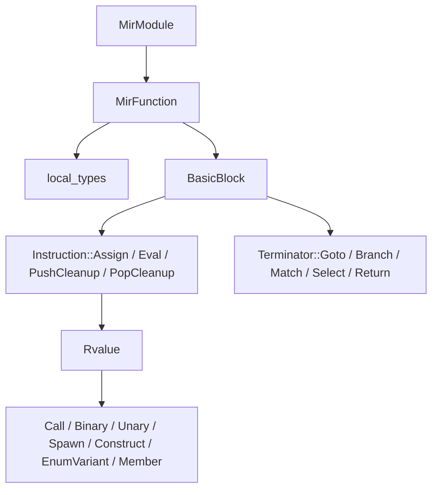

# MIR

This chapter explains what MIR is, why Aura uses it, and how Aura lowers checked programs into it.

## What MIR is

MIR stands for middle intermediate representation.

It sits between:

- the high-level checked program (`Program`)
- the concrete execution backends (MIR runtime and native codegen)

Aura's MIR is defined in [`mir.rs`](../crates/aura-compiler/src/mir.rs).

## Why Aura does not execute the AST directly

The AST is good for representing source syntax. It is not ideal for execution or code generation because it still contains:

- many high-level syntactic forms
- expression nesting that is convenient for humans but awkward for runtimes
- block syntax rather than explicit control-flow edges

MIR solves that by turning checked programs into a more execution-shaped form.

## The main MIR data structures

Aura's MIR centers around these types:

| Type | Purpose |
| --- | --- |
| `MirModule` | Whole lowered program: functions, classes, trait impls, optional top-level script |
| `MirFunction` | One function body with locals, entry block, and blocks |
| `BasicBlock` | Straight-line instructions plus a single terminator |
| `Instruction` | Assignment, evaluation, and cleanup-stack operations |
| `Rvalue` | Computation that produces a value |
| `Operand` | A place or literal already ready to use |
| `Terminator` | Control-flow transfer such as `Goto`, `Branch`, `Match`, `Select`, `Return` |

## Aura's MIR shape



## What Aura lowers into MIR

Aura lowers:

- ordinary functions
- class methods
- trait impl methods
- imported public functions and methods
- top-level script bodies

That matters because both execution paths need a unified view of everything callable.

## How lowering works

Aura's `lower(program: &Program) -> MirModule` does three high-level jobs:

1. create MIR functions for functions, methods, trait impl methods, and top-level statements
2. create MIR metadata for classes and trait impl dispatch
3. lower each checked body into blocks and instructions using `Lowerer`

## The `Lowerer`

`Lowerer` is Aura's core MIR builder. It carries state such as:

- current block
- block counter and temp counter
- loop stack for `break` and `continue`
- return redirection state
- `with` cleanup stack
- local type information
- scoped names created while lowering patterns

This is where the AST stops looking like source code and starts looking like control flow.

## Example: `if` lowering

An `if` statement becomes explicit blocks:

- condition block
- then block
- else or next-condition block
- final merge block

That is much easier for both the MIR runtime and native codegen to execute.

## Example: `with` lowering

Aura lowers `with` by explicitly managing cleanup instructions:

- assign the resource into the bound place
- `PushCleanup { place }`
- lower the body
- emit `PopCleanup` on normal exit
- unwind cleanup stack on `return`, `break`, `continue`, or exceptional early exits such as `try`

That is one of the most important architectural uses of MIR in Aura: turning structured resource management into explicit runtime operations.

## A tiny MIR example in Rust

Here is a deliberately tiny MIR for integer addition:

```rust
#[derive(Debug)]
enum Operand {
    Place(String),
    Int(i64),
}

#[derive(Debug)]
enum Rvalue {
    Use(Operand),
    Add(Operand, Operand),
}

#[derive(Debug)]
enum Instruction {
    Assign { target: String, value: Rvalue },
}

#[derive(Debug)]
enum Terminator {
    Return(Operand),
}

#[derive(Debug)]
struct BasicBlock {
    instructions: Vec<Instruction>,
    terminator: Terminator,
}

fn lower_add_function() -> BasicBlock {
    BasicBlock {
        instructions: vec![Instruction::Assign {
            target: "tmp0".to_string(),
            value: Rvalue::Add(
                Operand::Place("left".to_string()),
                Operand::Place("right".to_string()),
            ),
        }],
        terminator: Terminator::Return(Operand::Place("tmp0".to_string())),
    }
}
```

That example is much smaller than Aura's real MIR, but it captures the idea:

- complex expressions become named temporaries
- work happens in straight-line instructions
- control flow is explicit at block boundaries

## Aura-specific MIR features

Aura's real MIR goes well beyond the toy example. It includes:

- `Try`
  `Result` propagation at the IR level
- `Construct`
  class-instance construction
- `EnumVariant` and `VariantPayload`
  enum creation and payload extraction
- `CallTarget::Member`
  method and member-call lowering with receiver-place writeback support, including `TaskGroup.start(...)` and `TaskGroup.start_soon(...)`
- builtin call lowering for `wait_any(...)` and `wait_all(...)`
  scheduler-backed task waiting through ordinary MIR call paths
- `ForRange`
  a specialized loop terminator for range iteration
- cleanup instructions
  explicit `PushCleanup` and `PopCleanup`

## Ownership in MIR

A module's `ownership` field says whether its MIR states ownership.

| Value | Meaning |
| --- | --- |
| `Implicit` | Each backend decides when a value gains or loses a reference. Lowering produces implicit MIR, and MIR without the field is implicit. |
| `Explicit` | The instructions below state each reference a value gains or loses. |

An explicit module may hold:

- `Retain { place }`, which creates one new reference to the value at
  `place`. The next consuming `Place(place)` operand in the same block
  takes it.
- `Release { place }`, which drops the value of a root local and leaves the
  local empty.
- `releases_on_error` on `Rvalue::Try`, the root locals the `Err` edge
  releases after the pending cleanups, in name order.

The shared validator refuses all three in an implicit module. It also
refuses a release of a projection, an unknown local, or a local that an
active loan holds, a retain of an unknown place, and `try` releases out of
name order.

`MirClass.copy` and `MirEnum.copy` mark a type whose values need no drop.
Lowering marks a class or enum by the rule union layout plans use. A
generic class and an enum with a payload of a type parameter are not
marked. MIR without the mark needs drop. The validator refuses a mark on a
type with a field or payload that needs drop.

`mir::lower` runs the ownership pass, so the module `aura mir` prints and
the native build path compiles is explicit. The native emitter carries out
what the module states (see Native Lowering below). The interpreter gains
nothing from the pass, so `aura run` lowers with `mir::lower_implicit` and
skips it. The interpreter treats `Retain` and `Release` as no-ops.

### Ownership Pass

`mir::ownership::insert_ownership` runs in `lower()` after the union plans,
and at the native boundary on an implicit module. It does nothing to an
explicit module. It tracks each root local whose value needs drop. Copy
builtins, `MirClass.copy`, `MirEnum.copy`, and union plans decide that.

- A backward liveness pass finds where each value dies. A loan, a closure
  that borrows a capture, and a `VariantPayload` result keep their source
  alive.
- A consuming `Place` operand of such a value gets a `Retain` right before
  its instruction.
- A value that dies inside a block is released right after its last use.
- A value that dies on an edge is released at the start of the successor
  when the successor has one way in, or when the edge leaves a `ForRange`.
  Otherwise the pass splits the edge with a new `%edgeN` block.
- A store to a root that still holds a value releases it first. When the
  right side reads the root, the value goes to a new temporary, then the
  root is released, then the temporary moves in.
- `Return` releases what is left, except `mut` parameters and the root it
  returns from.
- A `try` lists the roots that hold a value there, except `mut` parameters.
- Releases at one point come out in name order.
- Nothing goes between `IndexInRange` and the access it covers, or between
  a call and the returned loan that follows it.
- A block that ends in `Unreachable` or `AssertFail` releases nothing. The
  abort reclaims every value.
- A match chain whose arms cover every variant of an enum has no
  fall-through edge for the pass or the checker. No value takes it.

A module the pass cannot read stays implicit, and the validator reports
what is wrong with it. `strip_ownership` takes the pass's output out again,
and tests use it to forge implicit MIR. A move the pass made stays a move.

### Pair Cancellation

`cancel_retain_release_pairs` runs last in the pass. It turns
`Retain(x)`, a consumer of `Place(x)`, and a later `Release(x)` into one
consumer of `MovePlace(x)`. A retain right before a `Return(Place(x))`
cancels against the release the return makes. It works on roots only.

- The root must allow an owned take. A `Borrow` or `BorrowMut` parameter
  never moves.
- A root read from a loan, or one that another value borrows, never moves.
- An element-loan selector never moves, because the loan keeps it.
- A repeatable closure's capture never moves, because each call reads it
  again.
- The consumer must touch the root once, by consuming it whole.
- Nothing between the consumer and the release may touch the root, retain
  it, or list it in a `try`. A moved `try` operand leaves the `try` list.

Each rewritten function must still pass the loan validator and the
ownership checker. When it does not, the pass keeps pairs one at a time
and drops each pair that fails.

### Ownership Checker

`validate_ownership` runs next to `validate_loan_flow` at both boundaries.
It walks each function forward and gives each tracked root a state.

| State | Meaning |
| --- | --- |
| Empty | holds no value |
| Owned | holds a value |
| Maybe | holds a value on some paths only |

Joining Owned with Empty gives Maybe. A path that never stored the root
adds nothing, because definite assignment is the type checker's rule.

- Parameters and the receiver start Owned. Every other root starts Empty.
- A use, a retain, or a move needs Owned. A move leaves the root Empty.
- A store to a root needs it Empty.
- Each consuming `Place` operand takes one earlier `Retain` in the same
  instruction, and none is left over.
- A release needs Owned or Maybe.
- A release or a move needs no active loan of the root and no registered
  cleanup on it.
- A task argument is never retained, because a task copies its arguments.
- A `try` must list exactly the roots that hold a value, except `mut`
  parameters.
- A return leaves every root Empty, except `mut` parameters, which stay
  Owned, and the root it returns from.

The checker has the loan validator's budgets: a cap on roots times blocks,
and a cap on block visits. Native emission runs it on every module, after
the pass fills in an implicit one. The interpreter runs it only on an
explicit module. Each error names the function. The interpreter reports it
after `invalid MIR ownership:`, and native emission reports it as it is.

### Operand Roles

`mir::ownership::operand_roles` and `terminator_roles` give each operand a
role. A consuming operand takes one reference to its value. A borrowing
operand reads the value and leaves it in place. A `MovePlace` operand
always moves.

| Role | Operands |
| --- | --- |
| Consume | `Use`, `Try`, `CallableAdapt`, and `UnionInject` values; the receiver and arguments of `Name`, `Value`, `Member`, and `TraitMember` calls; literal elements, `Construct` fields, and `EnumVariant` payloads; closure captures passed by value; `WriteLoan` values; element-loan selectors; `Return` |
| Borrow | `Binary`, `Unary`, and `Cast` operands; `Member`, `TupleElement`, and `VariantPayload` objects; f-string parts; `Eval`, `Branch`, `Match`, and `ForRange` operands; the function a `Value` call calls; extern call arguments; task inputs; assertion operands |

A runtime operation names the role of each argument in
`RuntimeOp::arg_ownership`. An `own` parameter consumes, and so do the key
and value an index write stores and the values a span restore puts back.
Every other argument borrows. `RuntimeOp::receiver_ownership` borrows the
receiver of every operation that has one.

### Native Lowering

The native emitter follows an explicit module.

- `Release` drops the root's value by its layout: an opaque handle, the
  active member of an inline union, or the captures of an inline callable.
  It then zeroes the root's words. A plain class owns no handle.
- `Retain` pays for the consumer that follows. The consumer adds the
  reference by layout when it hands the value on. A consumer that only
  borrows, such as a call dispatched on a boxed generic receiver, adds
  none.
- `MovePlace` takes the value out of its root.
- A store to a tracked root adds no release, because the module released
  the old value first.
- `Return` releases the root it returns from after the pending cleanups.
  The `try` error edge releases its list after the cleanups. `mut`
  parameters go back to the caller through the writeback.
- A match chain that covers every variant traps on its fall-through edge,
  where the module releases nothing.

The module does not track a Copy value, but this backend boxes some of
them: narrow integers, `Duration`, Copy enums, and tuples of Copy values.
The emitter releases such a root before a store over it and at each
return.

Each instruction's layout temporaries live in `LayoutScratch`: boxed
copies, fresh copies from projections, and values a consumer has not
taken yet. The end of the instruction releases what is left, and debug
builds check that the set is empty at each instruction boundary. Lending,
borrowed-element fusion, proven-access adjacency, and the tag elision in
`no_call_since` work as before.

Debug builds of the direct runtime refuse a release of a value that the
task's ledger does not hold, so every debug run of a native program checks
for over-releases. The ledger already checks that a completed task holds
no owned value.

## Why both backends benefit from MIR

Aura uses the same MIR for:

- `mir_runtime.rs`
- `native_codegen.rs`

That gives the project a strong architectural advantage:

- the runtime and codegen reason about one shared IR
- tests can validate lowering once and reuse it across execution paths
- new language features can first gain MIR support and then reuse that support in multiple backends

## Files worth studying

- [`mir.rs`](../crates/aura-compiler/src/mir.rs)
- [`mir_tests.rs`](../crates/aura-compiler/src/mir_tests.rs)
- [`mir_runtime.rs`](../crates/aura-compiler/src/mir_runtime.rs)
- [`native_codegen.rs`](../crates/aura-compiler/src/native_codegen.rs)

## What comes next

Read [07-mir-runtime.md](07-mir-runtime.md) to see how Aura executes MIR directly.
