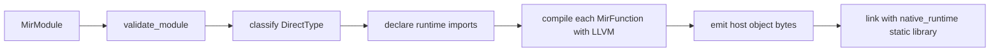

# Native Codegen And Runtime

This chapter explains Aura's direct native backend and the runtime ABI it targets.

## What code generation is

Code generation is the stage that turns an intermediate representation into machine-level artifacts.

In Aura, the direct backend:

- takes `MirModule`
- uses LLVM 22 to emit native code into object files, one per codegen unit
- links those object files against Aura's direct runtime

The code generator lives in [`native_codegen.rs`](../crates/aura-compiler/src/native_codegen.rs). The runtime ABI it targets lives in [`native_runtime.rs`](../crates/aura-runtime/src/native_runtime.rs).

## Native build backend

`aura build` always emits through the direct backend. `--backend direct` and
`--backend auto` are accepted spellings of that one backend. No MIR-runtime
launcher fallback exists. The flag is parsed in
[`crates/aura/src/main.rs`](../crates/aura/src/main.rs).

## The direct backend pipeline



## Aura's type strategy for native codegen

Aura does not lower every value the same way.

`native_codegen.rs` classifies values into:

- `DirectType::Scalar`
  simple scalar values such as integers, floats, bool, and unit
- `DirectType::PlainClass`
  classes that can be passed directly as flattened fields
- `DirectType::Opaque`
  rich values that are boxed and passed through runtime pointers

This is one of the most important design choices in Aura's native backend.

### Why this matters

It lets Aura avoid boxing everything while still supporting rich language features.

- simple data can stay cheap
- complex data can still reuse runtime semantics
- the code generator does not need bespoke low-level handling for every value form

## Runtime imports instead of inlined complexity

Aura's native codegen does not implement every builtin directly in generated machine code.

Instead, it declares many runtime functions such as:

- string helpers
- vector/map/set helpers
- queue/task helpers
- file/network helpers
- enum and instance helpers
- boxing/unboxing helpers

That keeps code generation smaller and keeps runtime semantics centralized.

## The role of `native_runtime.rs`

The direct runtime is Aura's native ABI layer. It is responsible for:

- hosting boxed `OpaqueValue` objects
- explicit refcount management
- numeric operation helpers
- string and collection helpers
- queue/task operations
- direct file and networking builtins
- runtime diagnostics with source context
- once-only typed call-frame and task-ancestry capture

Aura uses explicit retain/release helpers because generated code may pass opaque pointers around independently of Rust's normal ownership system.

Generated functions publish static frame metadata and push/pop native call
records around Aura calls. Direct task state also owns the task-entry and
parent-spawn records needed to reconstruct ancestry. A trap captures both
lists before generated cleanup or forced stack reset, using the same
compiler-owned diagnostic types and ordering as the MIR runtime.

### Frame Records

Every generated Aura function records its call in its task's frame stack,
and generated code does the common push and pop itself. A trap reads the
same records as the runtime paths write, so traces, task ancestry, and the
depth limit of 256 calls stay exact.

- **The stack.** Each task's runtime state owns one `DirectFrameStack` at a
  fixed heap address. An entry is the address of the function's static
  `DirectFrameDescriptor`, or a boxed frame record with the low bit set.
  The first 64 entries live inside the stack. A deeper call moves them to
  a heap block that doubles and is kept.
- **The header.** Generated code reads `len`, `limit`, `floor`, `flags`,
  and `entries` at the offsets of `DirectFrameStackLayout`. The program
  checks the layout's fingerprint at startup, as it does the list layout.
- **Push.** A function's entry calls `aura_direct_frame_stack`. It stores
  its descriptor at `entries[len]` and adds one to `len` when
  `len < limit` and `flags == 0`. Otherwise it calls
  `aura_direct_enter_frame`, which grows the stack, raises the depth trap,
  or takes the pending mutable sinks.
- **Pop.** A return subtracts one from `len` when `len > floor` and
  `flags == 0`. Otherwise it calls `aura_direct_exit_call`, which hands a
  returned view to the caller and frees a boxed record.
- **Limit and floor.** `limit` is the smaller of the capacity and
  `floor + 256`. Cleanup that runs during a trap sets `floor` to `len`, so
  its calls count their own depth and never pop the trapped calls.
- **Flags.** The runtime sets a flag while a call hands mutable sinks to
  its callee, while any call holds a returned-view record, and while the
  stack holds a boxed record. Each push and pop then takes the runtime
  path.
- **Validation.** The main wrapper passes every descriptor to
  `aura_direct_validate_frame_descriptors` before the first call, so an
  inline push stores only descriptors whose text is valid UTF-8.

The accessor keeps the current task's stack in a scheduler slot, which
every task switch clears. A task's stack keeps its address while the task
lives, so every call from one task returns the same address. LLVM sees the
accessor as `memory(none)` and merges a function's calls into one, even
across a yield. The runtime paths are cold blocks.

## `OpaqueValue` and refcounting

`native_runtime.rs` defines:

- `OpaqueValue`
  the heap box holding a `Value`
- `retain_ref_count`
- `release_ref_count`

The key idea is:

- generated native code can cheaply pass opaque values as pointer-sized handles
- the runtime preserves Aura semantics by storing real `Value` data behind those handles

### Ownership Ledger

Each task keeps a ledger of the references it owns. When the task fails or
is cancelled, the runtime releases every reference in it, so no box leaks.

- **Links.** The ledger lives in the task's `DirectFrameStack`. A value
  confined to its thread links into the ledger of the first task that owns
  it. Its header names that stack, counts the references the task owns,
  and holds the list links. Adding and removing a reference is O(1) and
  needs no hashing.
- **Counts by address.** A shared value never links, because another
  thread may read its header. Neither does a value that another task's
  ledger links. The ledger counts those references in a small map.
  `share_direct_value` moves a linked value's count into that map before
  it publishes the lock.
- **Inline retain and release.** Each module defines `aura_owned_retain`
  and `aura_owned_release`, and LLVM inlines them into every caller. They
  read the lock word first. A confined value linked into the running
  task's ledger has its count and its owned count changed in place. When
  the ledger holds the last reference it links, the release calls
  `aura_direct_release_last_owned_value`, which unlinks the value and
  frees it at zero without a lookup. Every other value goes to
  `aura_direct_retain_value` or `aura_direct_release_value`.
- **Layout.** Generated code reads the offsets of
  `DirectOwnershipLayout`. The program checks its fingerprint at startup.
- **Counters.** While the representation counters count ownership, no
  value links, so every retain and release reaches the runtime.
- **Box cache.** Each thread keeps up to 256 freed boxes in
  `native_box_cache.rs`, and boxing a value takes one before it calls the
  allocator.

### Lookups, Variants, And Tags

Native code skips work the runtime used to repeat on every lookup, match,
and tag.

- **Lookup slots.** `native_codegen_lookups.rs` finds each compiler
  temporary that holds a `dict` `get` result and is only matched on
  `Lookup.Found` or `Lookup.Missing`, unpacked once, and released. Such a
  slot holds the found value's own box, or null for `Lookup.Missing`. The
  `*_payload` forms of the `get` helpers fill it, so no `Lookup` is built
  or tagged. The match tests the word for null, and the unpack retains the
  box. A slot that is unpacked twice, or in a loop without a new `get`,
  keeps the `Lookup`, because two copies would share one box.
- **Scalar payloads.** A payload copied into an `int32`, `int64`,
  `uint64`, or `bool` local is read in place by
  `aura_direct_variant_payload_i64` and its siblings. Their errors match a
  boxed payload followed by an unbox, word for word.
- **Names.** `EnumVariantValue` keeps its names as `RuntimeName`, either
  a static string or a shared `Arc<str>`. A copy of a value shares its
  names. `aura_direct_enum_variant` keeps a small per-thread table of the
  names it decoded from each literal, so a loop that builds variants
  allocates no names.
- **Tag cells.** Each module has one writable word per type descriptor.
  `aura_direct_tag_value_type_cell` decodes the descriptor on first use
  and keeps the tag in that word. A tag for a plain nominal type, such as
  `json.Value`, records the name and touches nothing else in the value.
- **f-strings.** An f-string that starts with an `int64` part begins with
  `aura_direct_format_begin_i64`. It writes the leading literal and the
  digits into one buffer sized for the later parts.

### The `str` View

A `list[str]` can expose where its elements lie, so a loop compares them
with a literal without a runtime call.

- **Entries.** `DirectListAccess::Str` is a list form whose view points at
  one `DirectStrViewEntry` per element: the address and length of its
  UTF-8 bytes. The list's `VecValue` owns the entries in its
  `StrViewCache`, so the box keeps its size, and a copy of the list starts
  without them. `DirectListLayout`'s fingerprint covers the code and the
  entry layout.
- **Building.** A confined list's view starts as `Values`. Each
  `aura_direct_compare_str_literal_at` call counts a miss. Once the misses
  since the last build reach an eighth of the length, the runtime records
  every element and switches the view to `Str`. A list that holds any
  other value keeps `Values`. Each build is paid for by the misses before
  it, so a list that changes between reads costs a constant factor more
  at most.
- **Writes.** Every write refreshes the view to `Values`, as it does for
  the other forms, so a stale entry is never read. A shared value's view
  stays `None`.
- **Generated code.** `==` and `!=` between a lent `str` element and a
  literal check the code, the index, and the length inline. When the
  lengths match, `aura_direct_bytes_equal` compares the bytes. Any other
  case calls `aura_direct_compare_str_literal_at`, which reports the same
  diagnostics as before.

### Scalar Keys

`dict` and `set` keep their keyed SipHash hasher, with keys chosen once
per process. A scalar or `str` key reaches it with one write.

- **Integers.** An integer key writes its value as one `i64` when it fits,
  and as its 128 bits otherwise. The word depends on the value alone, so
  an `int32` and an `int64` that compare equal hash alike.
- **Other keys.** A `float` writes its bits, with `-0.0` as `0.0`. A
  `bool` writes one byte, and a `str` writes its bytes. Tuples, instances,
  and every other key take the structural walk, as before.
- **Inserts.** A probe returns the hash it computed, so an insert that
  misses reuses it for the index instead of hashing the key again.
- **Unboxed keys.** `add` and `in` on a `set[int64]` call
  `aura_direct_set_insert_int64_in_place` and
  `aura_direct_set_contains_int64`. `get` and `in` on a dict with `int64`
  keys call `aura_direct_map_get_int64`, or its payload form, and
  `aura_direct_map_contains_int64`. Each passes the key as a word, and the
  runtime compares it with stored keys of any integer width without
  building a value.
- **Order.** Entries stay in insertion order, so the hash never changes
  what a program prints.

### In-Place Appends

A list that keeps unboxed scalars can take an `append` without a runtime
call.

- **Room.** `OpaqueValue::list_capacity` is a `u32` count of the elements
  the storage has room for. It shares a word with the ledger count, which
  is a `u32` too, so the box keeps its 192 bytes. `DirectListLayout`
  gives its offset, and the fingerprint covers it.
- **Setting it.** Every write sets the room from the storage's capacity,
  but only for a confined list in the `int64`, `float64`, or `bool` form
  whose storage no other list shares. Any other value, a shared value, and
  a new box have no room. A list's first `append` after boxing calls the
  runtime and gives it room.
- **Generated code.** `append` checks the form and that the view's length
  is below the room. It then stores the element past the end and raises
  the view's length. A full list, or one in another form, calls
  `aura_direct_vec_push_scalar`, which grows the storage or converts the
  form, and refreshes the view as every write does. A `str` view is not a
  scalar form, so an append to that list calls the runtime and switches
  the view back to `Values`.
- **Taking elements in.** The storage's own length lags until the runtime
  next touches the value. `OpaqueValue::access` checks the room first. When
  it is set, the runtime sets the storage's length to the view's length
  and takes the room back, so every read, copy, and move sees each
  element, and a copy never shares room with the original. Sharing a value
  with another thread takes the elements in first.
- **Readers of other values.** The readers of a `dict`, a `set`, an enum
  variant, or a scalar take `access_unlisted`, which skips the check. A
  list handed to one of them only reaches its type error.

### In-Place Element Writes

`xs[i] = v` and `xs[i] op= v` on a `list[int64]`, `list[float64]`, or
`list[bool]` store the element without a runtime call or a box.

- **The op.** Lowering picks `ListOp::SetIndexScalar(kind)` for a write to
  a list of one of these element types, as it picks `IndexScalar` for a
  read. The value passes as its bits.
- **Generated code.** The write checks the form, normalizes a negative
  index and checks it against the view's length, then checks that the
  position is below the room. Room covers every element of storage no
  other list shares, so a list with shared storage has none and the store
  cannot reach another list. It then stores the bits in place. Any other
  list, a list without room, or an index out of range calls
  `aura_direct_vec_set_index_scalar`, which copies shared storage,
  converts the form, or reports the same diagnostic as
  `aura_direct_vec_set_index_in_place`. That call refreshes the view, so
  the next write is in place.
- **The receiver.** The write changes the value the receiver's handle
  holds, so the emitter skips storing the receiver back into a plain local
  or parameter (`store_receiver_back_in_place`), as `append` does. A
  mutable parameter still publishes the value to its caller's write-through
  sink when the caller registered one. The runtime fixes a call's sinks
  when the call starts, so the emitter asks for each sink once per call, at
  its first use, and caches it in a variable. A write on a call without a
  sink then costs one compare.

### Lent Lookups

A lookup slot whose found value is only read borrows the stored value
instead of copying it into a new box.

- **The proof.** `lent_lookup_places` in `native_codegen_lookups.rs`
  takes a lookup slot that is assigned once and read from a local
  collection. It follows the found value into each local it is copied
  into. Each of them must be assigned once and only retained, released,
  matched, or unpacked into an `int32`, `int64`, `uint64`, or `bool`
  local. While any of them is live, the function may run only those
  steps, scalar arithmetic, and plain branches. A call, a write, or a
  release of the collection fails the proof, and the slot keeps the copy.
- **The word.** A lent slot holds null for `Lookup.Missing`, an owned box
  as before, or the stored value's address with the low bit set. The
  `_lent` forms of the `get` helpers fill it. They lend only from a
  confined collection, and only a value whose copy cannot fail: a leaf,
  or an enum variant whose payloads are all leaves. Any other value comes
  back as an owned copy, so every error stays word for word the same.
- **Reading it.** `aura_direct_lent_variant_matches` and the
  `aura_direct_lent_variant_payload_*` readers take either form.
  Generated retain and release skip a word with the low bit set.
- **Why not `Lend`.** MIR's `Lend` and `EndLend` move a place into a
  temporary for one call. A lookup result is a fresh value whose uses
  cross blocks, so the check sits beside the lookup slots instead.

## A tiny direct-backend design example

This miniature example does not use LLVM, but it shows the same architectural split: simple values are direct, complex values are boxed.

```rust
#[derive(Debug, Clone)]
enum Type {
    Int,
    Bool,
    Vec,
}

#[derive(Debug, Clone)]
enum DirectType {
    Scalar,
    Opaque,
}

fn classify(ty: &Type) -> DirectType {
    match ty {
        Type::Int | Type::Bool => DirectType::Scalar,
        Type::Vec => DirectType::Opaque,
    }
}

fn emit_add(left: DirectType, right: DirectType) -> Result<&'static str, String> {
    match (left, right) {
        (DirectType::Scalar, DirectType::Scalar) => Ok("emit native integer add"),
        _ => Err("route through runtime helper instead".to_string()),
    }
}
```

Aura's real backend is more advanced, but the design lesson is the same:

- classify values
- emit fast paths for simple cases
- call runtime helpers for rich behavior

## LLVM's role

Aura uses LLVM to:

- create function signatures
- build IR blocks and instructions
- promote variables to SSA values
- optimize each object with `default<O3>`
- emit object code for the host target

Aura still does the language-specific work itself:

- mapping MIR semantics onto code generator operations
- deciding when to box or flatten
- selecting runtime helpers
- validating that the MIR shape is supported by the direct backend

## The code generator interface

The emitter reaches LLVM only through
[`native_backend.rs`](../crates/aura-compiler/src/native_backend.rs). It
defines two traits:

- `ModuleBackend` declares functions and data, defines them, and writes the
  object file. A function definition takes a closure that builds the body.
  `finish` writes one object. `finish_units` may write several, one per
  codegen unit, and `aura build` links them all.
- `FunctionBackend` builds one body: blocks with parameters, variables,
  stack slots, and one method per instruction kind the emitter uses, such
  as `iconst`, `call`, `brif`, `load`, and `fcmp`. A call returns its
  results directly.

Values, blocks, variables, stack slots, instructions, and declared
functions and data are `u32` handles, and scalar types, condition codes,
memory flags, trap codes, linkage, and signatures are the module's own
types. A signature names one of two calling conventions: Aura's private
one, which may return many values, or the C ABI that the runtime calls.

A few methods serve the emitter's retain and release peepholes: the type
of a value, the constant an `iconst` defines, whether only allowed calls
follow an instruction in the current block, and rewriting an earlier call
as another call, a copy, or nothing.

Two methods are hints that change no result. `mark_task_invariant` says a
runtime import returns the same value on every call from one task and
touches no memory its callers see. `set_cold_block` says a block rarely
runs. The frame record paths use both.

## The LLVM code generator

[`native_backend_llvm.rs`](../crates/aura-compiler/src/native_backend_llvm.rs)
implements both traits with LLVM 22 through inkwell. It is the only
implementation. It records each body in a small instruction list of its
own while the emitter builds it, so the peepholes inspect and rewrite the
instructions they built. `use_var` answers from the variable's last
definition in the current block, or in a chain of sealed blocks with one
predecessor each, as an SSA builder does, so the peepholes see the same
constants. `finish` then lowers the whole object to LLVM IR in one context:

- Blocks become basic blocks and block parameters become phis. An entry
  block holds an alloca for each variable and stack slot, and `mem2reg`
  and SROA promote the variables.
- Values are 64-bit integers. A load or store turns its address into a
  pointer, and `func_addr`, `symbol_value`, and `stack_addr` turn pointers
  back into integers.
- An Aura-convention function with many results returns one struct, which
  LLVM passes back through memory when it does not fit the return
  registers. Direct and indirect calls share that type. The C convention
  uses the C ABI.
- A trap calls `llvm.trap`. Divisions trap on a zero divisor and on the
  quotient that overflows, where LLVM would leave them undefined.
- Every function has an asynchronous unwind table, since a task failure
  unwinds through generated frames to the runtime's task boundary.
- A task-invariant import gets `memory(none)`, `nounwind`, and
  `willreturn`. A branch to a cold block gets `branch_weights` of 1 to
  2000.
- The target machine uses the host triple, the generic CPU, and PIC, and
  the module runs `default<O3>`.
- On ELF every defined function gets its own `.text.<symbol>` section after
  the passes run, so `--gc-sections` drops the ones nothing calls. LLVM
  marks Mach-O objects `MH_SUBSECTIONS_VIA_SYMBOLS`, so `-dead_strip` works
  per symbol there.

Tests that pin which functions the emitter defines and which helpers it
calls build their object with `without_optimization`, which skips the
passes on one thread. The parity matrix runs the optimized objects.

### Codegen units

`aura build` calls `finish_units`, which splits a large object into
codegen units, as rustc does. Each unit is its own LLVM module in its own
context. Threads lower, optimize, and write one unit at a time, largest
first, and the linker joins the objects.
[`native_backend_llvm_units.rs`](../crates/aura-compiler/src/native_backend_llvm_units.rs)
chooses the split:

- A function's weight is the number of instructions the emitter recorded
  for it. A module under 4,000 stays one unit, and that unit is the same
  object `finish` writes. Hello world weighs about 110, and the six phase 2
  benchmark programs 300 to 2,100, so they never split.
- A larger module splits into one unit per 3,000, from 2 to 16 units.
  Each unit takes a run of consecutive functions in declaration order, so
  a source function stays with its thunks and its neighbours. Data goes to
  the first unit that refers to it. The reference agent weighs about
  21,000 and splits into 8 units.
- A local function or data object that another unit refers to becomes a
  hidden global, so the executable exports nothing new. A unit that calls a
  function of at most 64 instructions in another unit, or one marked for
  inlining, gets an `available_externally` copy, so LLVM can still inline
  it. A unit that reads constant data of another unit gets a copy too, so
  LLVM can still fold the loads. LLVM drops every copy before it writes the
  object. Writable data is never copied.
- The split depends only on the module, never on the host's cores or on
  thread scheduling. Each unit's object comes from its own context, so
  the same program gives the same objects and the same executable on every
  run. `direct_objects_are_identical_across_repeated_builds` checks one
  object, and the codegen unit tests and the reference agent CLI test check
  split builds.

Split programs lose some cross-unit optimization: LLVM cannot inline a
large function of another unit, specialize its arguments, or change its
calling convention. Forcing the six benchmark programs into two or four
units moved their instruction counts by at most 0.15%.

[`scripts/install-llvm.sh`](../scripts/install-llvm.sh) installs the
static LLVM libraries `aura-compiler` links. See
[CONTRIBUTING](../CONTRIBUTING.md).

## Validation before emission

Before codegen, Aura validates the MIR module and functions. That protects the backend from malformed or unsupported input shapes.

This is good compiler engineering:

- reject impossible or unsafe IR early
- keep codegen assumptions explicit
- fail with diagnostics instead of generating nonsense

## How the direct runtime relates to the MIR runtime

The direct runtime and the MIR runtime are different execution engines, but they are designed to preserve the same language behavior.

They both depend on the same language-level concepts:

- `Value`
- class and enum semantics
- collection behavior
- task/queue behavior
- file and networking behavior
- numeric overflow and division diagnostics

They also produce the same complete structured diagnostics. Native execution
does not reconstruct frames from human stderr: when launched by `aura` on a
maintained Unix host, the runtime can write one bounded JSON diagnostic to a
private inherited file descriptor. The channel is used only for Aura traps;
ordinary nonzero program returns leave it empty. A successful structured write
suppresses duplicate human stderr, while a failed write retains the human
diagnostic.

## Generated task exit and scheduler teardown

Generated direct tasks suspend below generated native frames. Rust unwinding cannot
safely cross those frames on every supported platform, so the scheduler never
pretends that a forced reset is an ordinary unwind.

On normal return, direct task scope guards release the task's runtime state in
the usual way. A runtime trap or cooperative cancellation first uses the
direct-runtime boundary to run the language cleanup stack that the generated
program registered. The scheduler then resets the generated coroutine stack
and runs an exact-once containment callback. That callback releases the
argument buffer, its claim flag, tracked opaque-value references, and remaining
task-local direct-runtime state.

Scheduler teardown also covers both admission states. An unstarted prepared
direct task drops its entry closure and releases its external state exactly
once. A started but suspended direct task resets its generated stack and uses
the same containment callback. Direct root tasks use the forced-exit runner as
well, so a trapped, cancelled, or internally abandoned root cannot leave its
task-local ownership ledger behind.

This fallback is for host/runtime containment only. Once the generated stack
has been reset, it must not invoke arbitrary Aura cleanup thunks. Ordinary
source-level cleanup remains the responsibility of generated control flow and
the direct-runtime error boundary before forced exit; scheduler abandonment is
not a second language-level cleanup mechanism.

## Files to study

- [`native_codegen.rs`](../crates/aura-compiler/src/native_codegen.rs)
- [`native_codegen_lookups.rs`](../crates/aura-compiler/src/native_codegen_lookups.rs)
- [`native_backend.rs`](../crates/aura-compiler/src/native_backend.rs)
- [`native_backend_llvm.rs`](../crates/aura-compiler/src/native_backend_llvm.rs)
- [`native_runtime.rs`](../crates/aura-runtime/src/native_runtime.rs)
- [`native_codegen_tests.rs`](../crates/aura-compiler/src/native_codegen_tests.rs)
- [`native_runtime_tests.rs`](../crates/aura-runtime/src/native_runtime_tests.rs)

## What comes next

Read [09-packages-and-module-loading.md](09-packages-and-module-loading.md) to see how Aura finds modules, packages, workspaces, and dependencies before any of the execution paths run.
