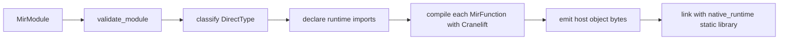

# Native Codegen And Runtime

This chapter explains Aura's direct native backend and the runtime ABI it targets.

## What code generation is

Code generation is the stage that turns an intermediate representation into machine-level artifacts.

In Aura, the direct backend:

- takes `MirModule`
- uses Cranelift to emit native code into an object file
- links that object file against Aura's direct runtime

The code generator lives in [`native_codegen.rs`](../crates/aura-compiler/src/native_codegen.rs). The runtime ABI it targets lives in [`native_runtime.rs`](../crates/aura-runtime/src/native_runtime.rs).

## Native build backend

`aura build` always emits through the direct backend. `--backend direct` and
`--backend auto` are accepted spellings of that one backend. No MIR-runtime
launcher fallback exists. The flag is parsed in
[`crates/aura/src/main.rs`](../crates/aura/src/main.rs).

## The direct backend pipeline



## Aura's type strategy for native codegen

Aura does not lower every value the same way.

`native_codegen.rs` classifies values into:

- `DirectType::Scalar`
  simple scalar values such as integers, floats, bool, and unit
- `DirectType::PlainClass`
  classes that can be passed directly as flattened fields
- `DirectType::Opaque`
  rich values that are boxed and passed through runtime pointers

This is one of the most important design choices in Aura's native backend.

### Why this matters

It lets Aura avoid boxing everything while still supporting rich language features.

- simple data can stay cheap
- complex data can still reuse runtime semantics
- the code generator does not need bespoke low-level handling for every value form

## Runtime imports instead of inlined complexity

Aura's native codegen does not implement every builtin directly in generated machine code.

Instead, it declares many runtime functions such as:

- string helpers
- vector/map/set helpers
- queue/task helpers
- file/network helpers
- enum and instance helpers
- boxing/unboxing helpers

That keeps code generation smaller and keeps runtime semantics centralized.

## The role of `native_runtime.rs`

The direct runtime is Aura's native ABI layer. It is responsible for:

- hosting boxed `OpaqueValue` objects
- explicit refcount management
- numeric operation helpers
- string and collection helpers
- queue/task operations
- direct file and networking builtins
- runtime diagnostics with source context
- once-only typed call-frame and task-ancestry capture

Aura uses explicit retain/release helpers because generated code may pass opaque pointers around independently of Rust's normal ownership system.

Generated functions publish static frame metadata and push/pop native call
records around Aura calls. Direct task state also owns the task-entry and
parent-spawn records needed to reconstruct ancestry. A trap captures both
lists before generated cleanup or forced stack reset, using the same
compiler-owned diagnostic types and ordering as the MIR runtime.

### Frame Records

Every generated Aura function records its call in its task's frame stack,
and generated code does the common push and pop itself. A trap reads the
same records as the runtime paths write, so traces, task ancestry, and the
depth limit of 256 calls stay exact.

- **The stack.** Each task's runtime state owns one `DirectFrameStack` at a
  fixed heap address. An entry is the address of the function's static
  `DirectFrameDescriptor`, or a boxed frame record with the low bit set.
  The first 64 entries live inside the stack. A deeper call moves them to
  a heap block that doubles and is kept.
- **The header.** Generated code reads `len`, `limit`, `floor`, `flags`,
  and `entries` at the offsets of `DirectFrameStackLayout`. The program
  checks the layout's fingerprint at startup, as it does the list layout.
- **Push.** A function's entry calls `aura_direct_frame_stack`. It stores
  its descriptor at `entries[len]` and adds one to `len` when
  `len < limit` and `flags == 0`. Otherwise it calls
  `aura_direct_enter_frame`, which grows the stack, raises the depth trap,
  or takes the pending mutable sinks.
- **Pop.** A return subtracts one from `len` when `len > floor` and
  `flags == 0`. Otherwise it calls `aura_direct_exit_call`, which hands a
  returned view to the caller and frees a boxed record.
- **Limit and floor.** `limit` is the smaller of the capacity and
  `floor + 256`. Cleanup that runs during a trap sets `floor` to `len`, so
  its calls count their own depth and never pop the trapped calls.
- **Flags.** The runtime sets a flag while a call hands mutable sinks to
  its callee, while any call holds a returned-view record, and while the
  stack holds a boxed record. Each push and pop then takes the runtime
  path.
- **Validation.** The main wrapper passes every descriptor to
  `aura_direct_validate_frame_descriptors` before the first call, so an
  inline push stores only descriptors whose text is valid UTF-8.

The accessor keeps the current task's stack in a scheduler slot, which
every task switch clears. A task's stack keeps its address while the task
lives, so every call from one task returns the same address. LLVM sees the
accessor as `memory(none)` and merges a function's calls into one, even
across a yield. Cranelift calls it at each push and pop. The runtime paths
are cold blocks on both code generators.

## `OpaqueValue` and refcounting

`native_runtime.rs` defines:

- `OpaqueValue`
  the heap box holding a `Value`
- `retain_ref_count`
- `release_ref_count`

The key idea is:

- generated native code can cheaply pass opaque values as pointer-sized handles
- the runtime preserves Aura semantics by storing real `Value` data behind those handles

### Ownership Ledger

Each task keeps a ledger of the references it owns. When the task fails or
is cancelled, the runtime releases every reference in it, so no box leaks.

- **Links.** The ledger lives in the task's `DirectFrameStack`. A value
  confined to its thread links into the ledger of the first task that owns
  it. Its header names that stack, counts the references the task owns,
  and holds the list links. Adding and removing a reference is O(1) and
  needs no hashing.
- **Counts by address.** A shared value never links, because another
  thread may read its header. Neither does a value that another task's
  ledger links. The ledger counts those references in a small map.
  `share_direct_value` moves a linked value's count into that map before
  it publishes the lock.
- **Inline retain and release.** Each module defines `aura_owned_retain`
  and `aura_owned_release`, and LLVM inlines them into every caller. They
  read the lock word first. A confined value linked into the running
  task's ledger has its count and its owned count changed in place. When
  the ledger holds the last reference it links, the release calls
  `aura_direct_release_last_owned_value`, which unlinks the value and
  frees it at zero without a lookup. Every other value goes to
  `aura_direct_retain_value` or `aura_direct_release_value`.
- **Layout.** Generated code reads the offsets of
  `DirectOwnershipLayout`. The program checks its fingerprint at startup.
- **Counters.** While the representation counters count ownership, no
  value links, so every retain and release reaches the runtime.

## A tiny direct-backend design example

This miniature example does not use Cranelift, but it shows the same architectural split: simple values are direct, complex values are boxed.

```rust
#[derive(Debug, Clone)]
enum Type {
    Int,
    Bool,
    Vec,
}

#[derive(Debug, Clone)]
enum DirectType {
    Scalar,
    Opaque,
}

fn classify(ty: &Type) -> DirectType {
    match ty {
        Type::Int | Type::Bool => DirectType::Scalar,
        Type::Vec => DirectType::Opaque,
    }
}

fn emit_add(left: DirectType, right: DirectType) -> Result<&'static str, String> {
    match (left, right) {
        (DirectType::Scalar, DirectType::Scalar) => Ok("emit native integer add"),
        _ => Err("route through runtime helper instead".to_string()),
    }
}
```

Aura's real backend is more advanced, but the design lesson is the same:

- classify values
- emit fast paths for simple cases
- call runtime helpers for rich behavior

## Cranelift's role

Aura uses Cranelift to:

- create function signatures
- build IR blocks and instructions
- manage variables and values
- emit object code for the host ISA

Aura still does the language-specific work itself:

- mapping MIR semantics onto code generator operations
- deciding when to box or flatten
- selecting runtime helpers
- validating that the MIR shape is supported by the direct backend

## The code generator interface

The emitter reaches Cranelift only through
[`native_backend.rs`](../crates/aura-compiler/src/native_backend.rs). It
defines two traits:

- `ModuleBackend` declares functions and data, defines them, and writes the
  object file. A function definition takes a closure that builds the body.
- `FunctionBackend` builds one body: blocks with parameters, variables,
  stack slots, and one method per instruction kind the emitter uses, such
  as `iconst`, `call`, `brif`, `load`, and `fcmp`. A call returns its
  results directly.

Values, blocks, variables, stack slots, instructions, and declared
functions and data are `u32` handles, and scalar types, condition codes,
memory flags, trap codes, linkage, and signatures are the module's own
types. A signature names one of two calling conventions: Aura's private
one, which may return many values, or the C ABI that the runtime calls.

A few methods serve the emitter's retain and release peepholes: the type
of a value, the constant an `iconst` defines, whether only allowed calls
follow an instruction in the current block, and rewriting an earlier call
as another call, a copy, or nothing.

Two methods are hints that change no result. `mark_task_invariant` says a
runtime import returns the same value on every call from one task and
touches no memory its callers see. `set_cold_block` says a block rarely
runs. The frame record paths use both.

[`native_backend_cranelift.rs`](../crates/aura-compiler/src/native_backend_cranelift.rs)
is the default implementation. Each handle is the index of the Cranelift
entity it names, so the emitter builds the same instructions in the same
order as it did through Cranelift directly, and objects stay byte for
byte the same. The Cranelift flags, the host ISA, per-function sections,
and the implicit return area for many return values stay inside it.

## The LLVM code generator

An `aura` built with the `llvm` cargo feature also has
[`native_backend_llvm.rs`](../crates/aura-compiler/src/native_backend_llvm.rs),
which generates code with LLVM 22 through inkwell. Setting
`AURA_NATIVE_CODEGEN=llvm` selects it. Unset, empty, or `cranelift` keeps
Cranelift, and any other value is an error, as is `llvm` in an `aura`
built without the feature. The native run cache keys on the selected code
generator, so one never reuses a program the other built.

The LLVM implementation records each body in a small instruction list of
its own while the emitter builds it, so the peepholes inspect and rewrite
the instructions they built, as they do on Cranelift. `use_var` answers
from the variable's last definition in the current block, or in a chain
of sealed blocks with one predecessor each, as Cranelift's SSA builder
does, so the peepholes see the same constants. `finish` then lowers the
whole object to LLVM IR in one context:

- Blocks become basic blocks and block parameters become phis. An entry
  block holds an alloca for each variable and stack slot, and `mem2reg`
  and SROA promote the variables.
- Values stay 64-bit integers, as on Cranelift. A load or store turns its
  address into a pointer, and `func_addr`, `symbol_value`, and
  `stack_addr` turn pointers back into integers.
- An Aura-convention function with many results returns one struct, which
  LLVM passes back through memory when it does not fit the return
  registers. Direct and indirect calls share that type. The C convention
  uses the C ABI.
- A trap calls `llvm.trap`. Divisions trap on a zero divisor and on the
  quotient that overflows, as Cranelift's do, where LLVM would leave them
  undefined.
- Every function has an asynchronous unwind table, since a task failure
  unwinds through generated frames to the runtime's task boundary.
- A task-invariant import gets `memory(none)`, `nounwind`, and
  `willreturn`. A branch to a cold block gets `branch_weights` of 1 to
  2000. Cranelift moves cold blocks to the end of the function.
- The target machine uses the host triple, the generic CPU, and PIC, and
  the module runs `default<O3>`.
- On ELF every defined function gets its own `.text.<symbol>` section after
  the passes run, so `--gc-sections` drops the ones nothing calls, as with
  Cranelift's per-function sections. LLVM marks Mach-O objects
  `MH_SUBSECTIONS_VIA_SYMBOLS`, as Cranelift does, so `-dead_strip` works
  per symbol there.

[`scripts/install-llvm.sh`](../scripts/install-llvm.sh) installs the
static LLVM libraries the feature links. See
[CONTRIBUTING](../CONTRIBUTING.md).

## Validation before emission

Before codegen, Aura validates the MIR module and functions. That protects the backend from malformed or unsupported input shapes.

This is good compiler engineering:

- reject impossible or unsafe IR early
- keep codegen assumptions explicit
- fail with diagnostics instead of generating nonsense

## How the direct runtime relates to the MIR runtime

The direct runtime and the MIR runtime are different execution engines, but they are designed to preserve the same language behavior.

They both depend on the same language-level concepts:

- `Value`
- class and enum semantics
- collection behavior
- task/queue behavior
- file and networking behavior
- numeric overflow and division diagnostics

They also produce the same complete structured diagnostics. Native execution
does not reconstruct frames from human stderr: when launched by `aura` on a
maintained Unix host, the runtime can write one bounded JSON diagnostic to a
private inherited file descriptor. The channel is used only for Aura traps;
ordinary nonzero program returns leave it empty. A successful structured write
suppresses duplicate human stderr, while a failed write retains the human
diagnostic.

## Generated task exit and scheduler teardown

Generated direct tasks suspend below Cranelift frames. Rust unwinding cannot
safely cross those frames on every supported platform, so the scheduler never
pretends that a forced reset is an ordinary unwind.

On normal return, direct task scope guards release the task's runtime state in
the usual way. A runtime trap or cooperative cancellation first uses the
direct-runtime boundary to run the language cleanup stack that the generated
program registered. The scheduler then resets the generated coroutine stack
and runs an exact-once containment callback. That callback releases the
argument buffer, its claim flag, tracked opaque-value references, and remaining
task-local direct-runtime state.

Scheduler teardown also covers both admission states. An unstarted prepared
direct task drops its entry closure and releases its external state exactly
once. A started but suspended direct task resets its generated stack and uses
the same containment callback. Direct root tasks use the forced-exit runner as
well, so a trapped, cancelled, or internally abandoned root cannot leave its
task-local ownership ledger behind.

This fallback is for host/runtime containment only. Once the generated stack
has been reset, it must not invoke arbitrary Aura cleanup thunks. Ordinary
source-level cleanup remains the responsibility of generated control flow and
the direct-runtime error boundary before forced exit; scheduler abandonment is
not a second language-level cleanup mechanism.

## Files to study

- [`native_codegen.rs`](../crates/aura-compiler/src/native_codegen.rs)
- [`native_backend.rs`](../crates/aura-compiler/src/native_backend.rs)
- [`native_backend_cranelift.rs`](../crates/aura-compiler/src/native_backend_cranelift.rs)
- [`native_backend_llvm.rs`](../crates/aura-compiler/src/native_backend_llvm.rs)
- [`native_runtime.rs`](../crates/aura-runtime/src/native_runtime.rs)
- [`native_codegen_tests.rs`](../crates/aura-compiler/src/native_codegen_tests.rs)
- [`native_runtime_tests.rs`](../crates/aura-runtime/src/native_runtime_tests.rs)

## What comes next

Read [09-packages-and-module-loading.md](09-packages-and-module-loading.md) to see how Aura finds modules, packages, workspaces, and dependencies before any of the execution paths run.
